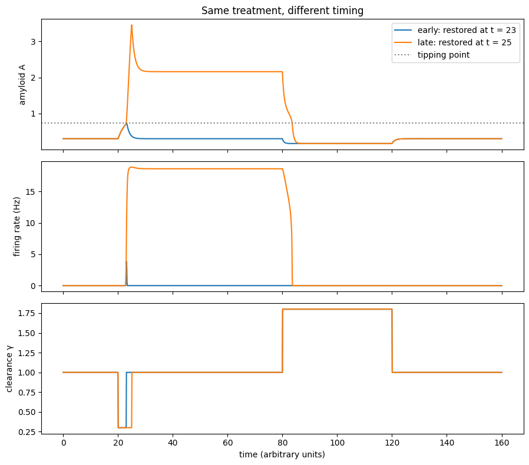
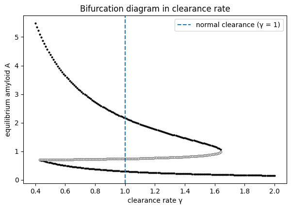
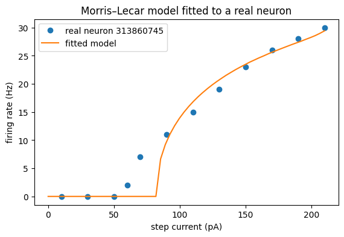

# Activity-Amyloid Feedback in a Model Alzheimer's Neuron

Final project for Biological Circuit Design, Fall 2026.

In early Alzheimer's disease, neuronal activity releases amyloid-beta (Aβ), and Aβ makes neurons more excitable. This project models that loop as a feedback circuit and asks whether it creates a tipping point: a level of Aβ beyond which restoring Aβ clearance no longer returns the neuron to a healthy state.

A Morris–Lecar neuron (milliseconds) is coupled to a slow equation for Aβ (hours to days). Using time-scale separation, the system is reduced to a single equation for Aβ, whose equilibria, stability and bifurcations are analyzed. The neuron is also fitted to a mouse layer 5 pyramidal cell from the Allen Cell Types Database.

## Main results

- **Loss of inhibition makes the neuron hyperexcitable -** Reducing the leak conductance to 40% of healthy lowers the firing threshold from 40 to 8 µA/cm². It moves the onset of depolarization block from 118 to 70 µA/cm². The same neuron can therefore be hyperactive under weak input and silent under strong input.

- **The activity–amyloid loop is bistable -** A healthy state (low Aβ, silent neuron) and a diseased state (high Aβ, neuron firing at about 19 Hz) are both stable, separated by an unstable tipping point.
  
- **Clearance shows hysteresis -** The healthy state is lost when clearance falls below 0.43 of normal, but once the neuron is diseased, restoring normal clearance does not reverse it. Recovery requires clearance 1.64 times normal (1.81 for the neuron fitted to real data).

- **The result is robust -** Bistability persisted for every parameter value tested in a sensitivity analysis, including without cooperativity in the Aβ effect, because the neuron's sharp firing threshold provides the switch.



*Two simulated patients go through the same temporary loss of Aβ clearance, differing by two time units. Only the patient whose Aβ has not yet crossed the tipping point recovers when clearance is restored. The other recovers only with a strong increase in clearance, and then stays healthy after it stops.*





## Methods

- **Neuron model:** Morris-Lecar model with the standard Class I (SNIC) parameters (Rinzel and Ermentrout).
- **Stability analysis:** nullclines, equilibria and Jacobian eigenvalues; the resting state is lost through a saddle-node bifurcation.
- **Firing-rate curve:** simulated f-I curves fitted with a Hill function.
- **Disease model:** loss of inhibition represented as a reduced leak conductance, controlled by Aβ through a Hill function.
- **Aβ dynamics:** dA/dt = k₀ + k₁·r - γA, reduced by time-scale separation so the neuron enters only through its steady firing rate r.
- **Bifurcation and hysteresis:** equilibria tracked across clearance rates γ, plus time-course simulations of treatment.
- **Fit to data:** current scale and K⁺ channel speed fitted by least squares to the f-I curve of Allen specimen 313860745; the method was first validated on synthetic data.
- **Sensitivity analysis:** each Aβ parameter varied from about half to double its value.

## Limitations

- Single neuron only; network inhibition and glial clearance of Aβ are represented by the leak conductance and the clearance rate.
- Loss of inhibition is modeled as a lower leak conductance, a simplification of synaptic GABA-A inhibition.
- Aβ parameters are dimensionless and chosen to show qualitative behavior, so the results describe mechanisms rather than patient-level predictions.
- The two-variable neuron enters depolarization block at lower relative inputs than the recorded cell, so its silencing predictions should be interpreted with caution.

## How to run

Open `alzheimers_neuron_project.ipynb` in Google Colab and choose **Runtime → Run all**. The Allen data is downloaded from the Allen Brain Map API, so an internet connection is needed. To run locally:

```
pip install -r requirements.txt
jupyter notebook alzheimers_neuron_project.ipynb
```

## Data

Electrophysiology data: Allen Cell Types Database, © 2015 Allen Institute for Brain Science. Available from: celltypes.brain-map.org.

## References

1. Busche MA, et al. (2008). Clusters of hyperactive neurons near amyloid plaques in a mouse model of Alzheimer's disease. *Science* 321:1686-1689.
2. Cirrito JR, et al. (2005). Synaptic activity regulates interstitial fluid amyloid-β levels in vivo. *Neuron* 48:913-922.
3. Zott B, et al. (2019). A vicious cycle of β amyloid–dependent neuronal hyperactivation. *Science* 365:559.
4. Morris C, Lecar H (1981). Voltage oscillations in the barnacle giant muscle fiber. *Biophysical Journal* 35:193–213.
5. Rinzel J, Ermentrout GB (1998). Analysis of neural excitability and oscillations. In *Methods in Neuronal Modeling*, 2nd ed. MIT Press.
6. Gouwens NW, et al. (2019). Classification of electrophysiological and morphological neuron types in the mouse visual cortex. *Nature Neuroscience* 22:1182-1195.

## 👩‍💻 Author
Mrunmayee Wankhede \
MS-QBB @ CMU
